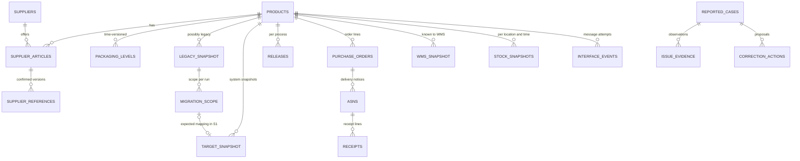

# Untersuchung von Produktdatenfehlern und Verfügbarkeitsproblemen im Rahmen einer ERP-Migration und Produkteinführung

## Phase 4 – Technische Datenarchitektur, Datenwörterbuch und kontrollierter Pilotdatensatz

**Version:** 1.0 · **Datum:** 25. Oktober 2026 · **Status:** Technischer Datengrundstock erzeugt und strukturell getestet. **Noch keine Umsetzung der fachlichen Qualitätsregel-Engine.**  
**Verbindliche Grundlage:** `Portfolio_Projekt_1_Fachkonzept_Phase_3.md` (fachlich freigegebenes Szenario, Regeln BR-01–BR-26 und Abnahmeklassen AT-01–AT-16).  
**Methodischer Status:** Die betrieblichen Vorgänge und Daten in diesem Projekt sind **vollständig simuliert**. Der historische Target-Canada-Fall ist ausschließlich die Quelle der allgemein dokumentierten Fehlermechanismen, *keine* Quelle der Datensätze.

---

## 1. Lieferumfang und zentrale Entscheidungen

Die Datenarchitektur ist für die fachlich begrenzte Untersuchung von **verpackten Hygiene- und Drogerieprodukten** ausgelegt. Die operative Frage lautet: *Welche Abweichung liegt vor, bei welchem Vorgang, auf welcher Verpackungsebene, in welchem Zeitstand – und ist sie ein Fehler, eine gültige Ausnahme oder noch nicht hinreichend nachweisbar?*

**Datenschnitte (Simulation, ISO 8601):**

| Kennzeichen | Stichtag | Zweck |
|---|---|---|
| T0 / S0 | 2026-09-01 | eingefrorener Legacy-Snapshot und Migrationskohorte |
| T1 / S1 | 2026-09-10 | Ziel-ERP-Auszug nach Datenübernahme, **vor** Neuartikeln |
| T2 / S2 | 2026-09-15 | Ziel-ERP-Auszug einschließlich neuer SKUs; Zeitpunkt der Bestellungen |
| T3 | 2026-09-16–17 | Lieferavise und ggf. genehmigte Packungsänderungen |
| T4 | 2026-09-17 | dokumentierte Wareneingänge, auch HOLD |
| T5 | 2026-09-18 | WMS-Artikelstatus, Lagerbestände und offene Klärungsfälle |

Die tatsächlichen Zeilenmengen werden durch die Mindestabdeckung der 16 beschlossenen fachlichen Abnahmeklassen bestimmt; es werden keine vermeintlich repräsentativen Fehlerraten oder Fallzahlen konstruiert. Das Ergebnis ist eine **kleine, didaktisch kontrollierte Pilotstichprobe**, nicht der Datenbestand eines Handelsunternehmens.

### 1.1 Bestandteile

- `daten_raw/`: 21 CSV-Tabellen; unbereinigte simulierte Systemstände und Geschäftsvorfälle.
- `Datenwoerterbuch.csv`: feldgenaue Typen, Datenherkunft, Schlüsselinformationen und Verknüpfungshinweise; **187 Spaltendefinitionen**.
- `sql/00_schema.sql`: in SQLite verwendbares physisches Landing-Schema.
- `Portfolio_Phase4_Rohdaten.sqlite`: vollständig befüllte, lokal ausführbare SQLite-Datenbank.
- `Portfolio_Phase4_Excel_Rohdaten.xlsx`: Arbeitsmappe mit Startseite und 21 Rohdatentabellen (keine Testantworten).
- `internes_testorakel/`: **separate** vorbereitete erwartete Resultate und Szenariozuordnung für die spätere Testabnahme.
- `skripte/erzeuge_datensaetze.py`: deterministische Neuerzeugung von CSV, SQLite, Datenwörterbuch und Testorakel.
- `skripte/pruefe_phase4.py` und `Pruefbericht_Phase_4.json`: reproduzierbare **Fixture-/Integritätstests**, keine fachliche Produktivvalidierung.
- `sql/01_erste_abfragen.sql`: ausführbare Einstiegsabfragen zum eigenständigen Erlernen der Tabellen.

### 1.2 Einordnung des Modells

Das Modell trennt **Rohdaten/Landing** von der späteren **analytischen Prüf- und Entscheidungsschicht**:

1. **RAW** – Ursprüngliche Dokument-/Systemwerte, auch absichtliche Lücken und Widersprüche.
2. **REFERENCE** – Simulierte, fachlich bestätigte Stammdaten und Regeln, zeitlich gültig; nicht mit empirisch bewiesener Herstellerwahrheit verwechseln.
3. **EVIDENCE** – Ereignisprotokolle, Freigaben, Belegverweise, ausdrücklich als vorhanden/fehlend/unbestätigt markiert.
4. **TEST** – Unabhängig von Rohdaten geführte Erwartung je Abnahmeklasse, nicht in der Excel-Arbeitsmappe oder RAW-Datenbank enthalten.
5. **ANALYSIS (Phase 5)** – Noch zu entwickelnde Regeln, Befunde, Ursachenklassifikation und Prozessfreigaben.

Das SQLite-Landing-Schema erzwingt technische Primärschlüssel, **nicht** die 26 Fachregeln. Diese Zurückhaltung ist beabsichtigt: Ein importierter Fehler muss im Rohdatenbestand erhalten bleiben und untersuchbar sein. Fehlende Querverweise (z. B. nicht vorhandener Zielartikel oder unbekannte Verpackungsversion) sollen **nicht** durch Foreign-Key-Sperren beim Laden verborgen werden.

---

## 2. Systemgrenzen und Datenhoheit

| Datenbereich | System / führender Nachweis | Abgebildete Rohdaten | Grenzen |
|---|---|---|---|
| Artikelidentität | fiktives Stammdatensystem | `products`, `supplier_articles`, `suppliers` | Interne SKU ≠ Lieferantenartikelnummer; gleiche Lieferantennummer bei anderem Lieferanten ist zulässig. |
| Lieferantenbestätigung | fachlich bestätigte Lieferanteninformation | `supplier_references`, `packaging_levels` | Ein nicht bestätigter Wert ist **kein** harter Sachfehlernachweis. |
| Migrationspflicht | genehmigter Umfang bei T0 | `migration_scope` | Exkludierter Altartikel ist kein Ladefehler. |
| Legacy-Snapshot | historisierter Quellsystemexport | `legacy_snapshot` | Feldwerte gehören zu S0, nicht zum heutigen Artikelzustand. |
| Mapping / Ladevorgang | Versionierte Umrechnungsregel + Ereignis | `mapping_rules`, `migration_events` | Ein fehlendes Ereignis lässt eine Ursache offen. |
| Ziel-ERP | Ziel-ERP-Export S1 und S2 | `target_snapshot` | Identitätsprüfung nur über genehmigte Zuordnung, nicht Namen. |
| Freigaben | Einkauf / Produktmanagement / Logistik | `releases`, `change_approvals` | Unterschiedliche Prozesse können unterschiedlich freigegeben sein. |
| Bestellung | bestätigte Bestellposition | `purchase_orders` | PO-Menge und Verpackung müssen bei Bestellung gültig sein. |
| Versandankündigung | Lieferanten-ASP/ASN (Simulation) | `asns` | Avis ist Erwartung, keine physische Lagerbestätigung. |
| WMS-Übergabe | Simulierter Message- und Empfangsstatus | `interface_events`, `wms_snapshot` | Kein echtes SAP-/Manhattan-Protokoll. |
| Wareneingang | Lagerereignis mit eigenem Status | `receipts` | `HOLD` ist physische Erfassung, nicht freier Bestand. |
| Bestand | WMS-Lager-Snapshot zum Zeitpunkt T5 | `stock_snapshots` | Systembestand ≠ tatsächliche Regalverfügbarkeit. |
| Untersuchung | gemeldete Symptome und Nachweise | `reported_cases`, `issue_evidence`, `correction_actions` | Ein Bericht enthält zunächst **keine** bestätigte Ursache. |

### 2.1 Kardinalitäten und Schlüssel

| Verbindung | Verknüpfung | Kardinalität / Risiko |
|---|---|---|
| Artikel → Lieferantenartikel | `products.sku = supplier_articles.sku` | 1:n; Lieferantenartikelidentität ist `(supplier_id, supplier_article_no, valid_from)` |
| Lieferantenartikel → bestätigter Referenzstand | `(supplier_id, supplier_article_no)` plus gültiger Zeitpunkt | 1:n über Referenzversionen; Freigabe und `valid_from`/`valid_to` beachten |
| Artikel → Verpackung | `sku`, `pack_version_id`, `level_code` | 1:n; EACH und CASE sind **verschiedene Ebenen** |
| Legacy → Scope | `legacy_record_id` und `migration_run_id` | je Lauf ein Scope-Entscheid; nicht jede Legacy-ID ist verpflichtend |
| Scope → Ziel | `expected_target_record_id = target_snapshot.target_record_id` **plus S1** | 0:1 erwartete Zielidentität im Migrationslauf; fehlende Ziele bleiben als NULL erkennbar |
| Mapping → Ereignis | `rule_version` und `applied_rule_version` im Kontext des Zielfeldes | Version und tatsächlicher Multiplikator zusätzlich prüfen |
| Bestellposition → ASN-Positionen | `(po_id, po_line_id)` | 1:n, Mengen nicht durch Multiplikation des PO-Werts über mehrere ASN-Zeilen verdoppeln |
| ASN-Position → Wareneingänge | `(asn_id, asn_line_id)` | 1:n; mehrfache Teilwareneingänge erlaubt |
| Produkt → WMS-Status | `sku` plus `wms_snapshot.snapshot_id` | 0:n; eine fehlende Ziel-WMS-Zeile und fehlendes Event sind nicht dasselbe |
| Fall → Evidenz | `reported_cases.case_id = issue_evidence.case_id` | 1:n; Belegverfügbarkeit und Evidenzbeurteilung bleiben getrennt |

**Zeitintervall-Konvention:** `valid_from` ist einschließlich, `valid_to` ausschließlich (*half-open interval*); eine leere obere Grenze bedeutet offen. Beim SKU `HYG-1008` wechselt `PK-1008-A` zu `PK-1008-B` am **16.09.2026**. Die Genehmigung erfolgt zuvor. Ein Packwechsel darf **nicht** mit einem Migrationsverlust verwechselt werden.

### 2.2 Schematische Beziehungen

Das Diagramm ist **fachlich**; es bedeutet nicht, dass alle Beziehungen bereits als harte Datenbank-Foreign-Keys umgesetzt sind. Offene Referenzen sind Teil der Untersuchung.

---

## 3. Konkrete Datentransfers und spätere Prüfstellen

| Datenvertrag aus Phase 3 | Technische Quellen und Zielfelder | Prüfung in Phase 5 |
|---|---|---|
| D1 Lieferant → Stammdaten | `supplier_articles` + `supplier_references` → `products` / `packaging_levels` | Identität, Gültigkeit, bestätigter Packstand |
| D2 Legacy → Ziel-ERP | `legacy_snapshot` + `migration_scope` + `mapping_rules` + `migration_events` → `target_snapshot` **S1** | genehmigter Scope, Identität, Feldtransformation, Importbeleg |
| D3 Ziel-ERP → Bestellung | `target_snapshot` **S2** + `releases` + `packaging_levels` → `purchase_orders` | beschaffbarer Artikel, UOM, Menge, gültige Version zum Bestellzeitpunkt |
| D4 Bestellung → Lieferant | `purchase_orders` → `asns` mit `(po_id, po_line_id)` | PO-Bezug und angekündigte Basismenge |
| D5 Lieferant → ASN | `supplier_references` + `change_approvals` + `asns` | angekündigtes Packformat, zulässige Änderung vor ASN |
| D6 Ziel-ERP → WMS | `target_snapshot` + `interface_events` → `wms_snapshot` | Senderkennung, quittierte Übergabe, korrekte WMS-Zuordnung |
| D7 PO/ASN/WMS → Wareneingang | `purchase_orders` + `asns` + `wms_snapshot` → `receipts` | Menge **und** Packstruktur, Verarbeitungsstatus |
| D8 Wareneingang → Bestand | `receipts` + `stock_snapshots` + `releases` | BLOCK/HOLD nicht als frei verfügbar; verfügbare Menge = on hand – reserviert – gesperrt |

**Unterscheide drei Urteile:** Regelergebnis `PASS/FAIL/NOT_EVALUABLE`; Prozessentscheidung `ALLOW/BLOCK/REVIEW`; Ursachenstatus `CONFIRMED/HYPOTHESIS/UNCONFIRMED/NOT_APPLICABLE`. Der gleiche Rohbefund darf unterschiedliche Prozessfolgen je Kontext haben.

---

## 4. Feld- und Datentypfestlegungen

Das vollständige **feldweise** Datenwörterbuch liegt in `Datenwoerterbuch.csv`. Die folgenden Punkte sind für fehlerfreie Nutzung entscheidend:

- **Schlüssel und Bezeichner:** `TEXT`; führende Nullen und Sonderzeichen bleiben erhalten. Eine Artikelnummer ist **keine** Zahl.
- **Ganzzahlmengen:** `INTEGER`; negative oder null Werte werden erst von **fachlichen** Regeln bewertet, soweit fachlich relevant. Null bedeutet fehlend/unklar, nicht null Stück.
- **Abmessungen, Umrechnungsfaktoren:** `REAL` in der SQLite-Pilotimplementierung; Fachsollwerte sollten später mit toleranzbewussten Prüfungen oder normierter Dezimaldarstellung verglichen werden.
- **Datumsfelder und Zeitstempel:** `TEXT` im ISO-8601-Format für transportable, unveränderte RAW-Exporte. Für Excel/Power Query und Power BI in typisierte Zeitwerte konvertieren. Für Vergleiche wird ein gemeinsamer Zeitzonenkontext vorausgesetzt; das Pilotmaterial enthält keine Zeitzonenoffsets, deshalb keine globalen Zeitbehauptungen.
- **Fehlende Werte:** In CSV leer; in SQLite `NULL`; nicht ohne Regel als `0` oder `FALSE` auswerten.
- **GTIN:** Im Pilot bewusst leer. Keine erfundenen GTINs mit behaupteter GS1-Vergabe. Prüfung der Packstruktur funktioniert anhand interner Versionen/Packcodes.
- **Maße und Gewichte:** Werte in der Datengrundlage sind vollständig synthetische Fixture-Angaben. Plausibilität belegt **nicht** die Richtigkeit realer Produkte. `measure_evidence = SYNTHETIC`.
- **Doppelter Lieferantenartikelcode:** `SAME-REF` existiert bei **zwei verschiedenen Lieferanten**; das verletzt keine lieferantenqualifizierte Identitätsregel.
- **Quell- und Zielidentität:** `legacy_record_id` und `target_record_id` unterscheiden sich; nur `migration_scope` erlaubt den akzeptierten Abgleich.

### 4.1 Beispiel: Versandeinheiten

Eine Bestellung kann `ordered_qty=10`, `order_uom=CASE`, `expected_case_qty=100` und `ordered_base_qty=1000 EA` enthalten. Ein ASN kann für dieselben 1.000 EA **vier Kartons zu je 250 EA** ankündigen. Dieser Vorgang ist **nicht** schon wegen identischer Gesamtmenge korrekt; erst eine zulässige, gültige Packversion und ihr Genehmigungsnachweis erlauben die alternative Struktur.

### 4.2 Beispiel: Migrationsabgleich

Nur Quellsätze aus `migration_scope` mit `in_scope = YES` gehören in den Nenner der verpflichtenden Migrationsabdeckung. Zum technischen Abgleich muss gezielt **S1** ausgewählt werden; bei S2 enthält das Zielsystem zusätzlich neue Artikel, die keine Legacy-ID benötigen. Eine fehlende S1-Zeile beweist einen Abgleichdefekt, **nicht automatisch** den verursachenden Schritt.

---

## 5. Übersetzung der 26 Phase-3-Regeln in Datenprüfbarkeit

| BR | Benötigte Datengrundlage | Implementierungsauftrag (Phase 5) |
|---|---|---|
| 01–06 | `legacy_snapshot`, `migration_scope`, `mapping_rules`, `migration_events`, `target_snapshot`, `products` | Scope, Identitätsabgleich, Kohortenzuordnung, regelgerechte Umrechnung, Ursachen-Evidenz |
| 07–09 | `products`, `supplier_articles`, `supplier_references`, `packaging_levels` | Pflichtbezug, EA-Grundeinheit, Hierarchie und positive Faktoren |
| 10–13 | `supplier_references`, `packaging_levels`, `change_approvals`, `supplier_articles` | Gültige Version, Packebene, optionale GTIN-Semantik, Maße/Einheiten, Lieferantenscope |
| 14–18 | `purchase_orders`, `asns`, `receipts`, `change_approvals`, `packaging_levels` | PO/ASN/Wareneingang je **Position**, Menge und Kartonstruktur, Teilmengen, Packchange |
| 19–21 | `receipts`, `stock_snapshots`, `interface_events`, `wms_snapshot` | Quarantäne, frei verfügbarer Systembestand, nachgewiesene/ungeklärte Integration |
| 22–26 | `products`, `releases`, `reported_cases`, `issue_evidence`, `correction_actions` | Neuartikel-Freigaben, Dreistatus-Prüfung, Ursachenbeleg, Re-Test, valide Geschäftsausschlüsse |

Diese Tabelle beschreibt das **Soll für Phase 5**, nicht eine bereits entwickelte Prüfengine. Die Szenarioklassen AT-01–AT-16 wurden als Fixtures eingebaut und getrennt im internen Testorakel mit erwarteter Entscheidung festgelegt.

---

## 6. Testaufbau, Offenlegung und Grenzen

**Trennung bewusst:** Die Rohdaten und die Excel-Arbeitsmappe enthalten **keine Testantworten**. Die Testspezifikation liegt im Ordner `internes_testorakel/`. Für Übungen zunächst nur Datenmappe, CSVs und `sql/01_erste_abfragen.sql` verwenden.

**Was bereits überprüft wurde:** Datenschema existiert, eindeutige technische PKs, Tabellen-/Datenwörterbuchabdeckung, beabsichtigte Verknüpfungen, Präsenz der 16 vorher definierten Szenarioklassen und wichtige zeitliche Ausnahmebedingungen. Ergebnis siehe `Pruefbericht_Phase_4.json`.

**Was noch nicht überprüft wurde:** Ob eine selbst entwickelte SQL-Regel-Engine jeden Fall korrekt erkennt, Sensitivität/Präzision auf unbekannten Daten oder wirtschaftliche Wirkung im Handel. Diese Aussagen wären derzeit unzulässig.

**Besonders prüfungsrelevant:**

- Lieferanten-Packversion und PO-Version dürfen voneinander abweichen, **wenn** eine nachweislich vor ASN wirksame Änderung vorliegt.
- Ein fehlender WMS-Artikel mit fehlendem Event ist nicht dasselbe wie ein fehlgeschlagener WMS-Transfer mit belastbarem Event.
- `HOLD`-Mengen können im physischen `on_hand` enthalten sein und müssen vollständig als `blocked` berücksichtigt werden, damit `available = 0` gilt.
- Eine ausbleibende Freigabe kann zulässig sein; manche neue Produkte sind noch gar nicht operativ eingeführt.
- Der Korrekturbeleg enthält eine **vorgeschlagene** Änderung; ohne Ausführung und abhängige Revalidierung bleibt der Fall offen.
- Aufgrund des bewusst kleinen, kuratierten Testbestandes sind abgeleitete Quoten **keine** Aussagen über übliche Unternehmensdatenqualität.

---

## 7. Phase-4-Abnahme und nächster Arbeitsschritt

**Abgeschlossen:** Feldstrukturen, Datenhoheit, technische CSV-/SQLite-/Excel-Lieferung, Datenwörterbuch, Zeit- und Versionslogik, getrenntes internes Oracle, reproduzierbare Datengenerierung sowie Fixture-Integritätsprüfung.

**Noch offen / nächste Phase:** Erstellung der Abfragen und Power-Query-Transformationen zur tatsächlichen Ausführung von BR-01–BR-26, Befundmodellierung, evidenzgestützte Ursachenanalyse, Korrekturlauf, Regressionstests und Power-BI-Auswertung. Begonnen werden sollte mit dem migrationspflichtigen Artikelabgleich (**U1**, BR-01–BR-06), anschließend Verpackungsprüfung und PO/ASN/Wareneingang (**U2**) und schließlich Freigabekontrollen für neue Produkte (**U3**).

---

## Quellenstatus und Evidenz

Die **historische Problembegründung** beruht auf Maclean’s / Canadian Business (*What really happened at Target Canada*, 22.01.2016): https://macleans.ca/economy/business/what-really-happened-at-target-canada-the-retailers-last-days/ . Der Bericht bestätigt Problemmechanismen, nicht den hier simulierten Datensatz. Allgemeine GS1-Konzepte zu Verpackungsebenen sind über https://www.gs1.org/ dokumentiert. Die Projektwerte sind ausschließlich eigene simulierte Lehrdaten.
